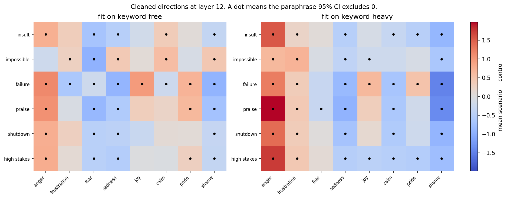

# Do LLMs get angry?

[](https://github.com/joshhlim/llm-emotions/actions/workflows/ci.yml)
[](https://colab.research.google.com/github/joshhlim/llm-emotions/blob/main/notebooks/01_emotion_directions.ipynb)
[](https://colab.research.google.com/github/joshhlim/llm-emotions/blob/main/notebooks/02_scenarios.ipynb)
[](https://colab.research.google.com/github/joshhlim/llm-emotions/blob/main/notebooks/03_performance.ipynb)

A small, open study of emotion-like **representations** and **behaviour** in open-weight language models. The title is a question used as a hook. The measurements are residual-stream directions, linear probes, and generated text.

This repository is the code, the datasets, and the experiment runner for that study. It is set up so later phases can be added without rewriting the loader, the probes, or the way results are saved.

## Caveats

Read these before quoting anything in the repo.

- The project studies representations and behaviour. It does not show that a model feels angry, afraid, proud, or anything else.
- Probe accuracy on the bundled contrastive set is a pipeline check, not a finding. The sentences name the emotions they are about ("furious", "ashamed", "overjoyed"), so a linear classifier can look strong by picking up those words.
- A direction can track sentiment, topic, or sentence length rather than one emotion.
- Phase 01 includes a steering demo on a single prompt. Damaged fluency at high strength is an observation about the intervention. It is not a performance result.
- Phase 03 changes the wording of a prompt and then reads the anger direction. That link is correlational. Steering the direction is phase 04, and it is not implemented.
- Figures under `docs/smoke_test_0.5b_cpu/` come from a CPU wiring check of `Qwen/Qwen2.5-0.5B-Instruct`. They show that the pipeline draws its plots. They are not results.

## Research questions

| Phase | Question | Status |
| --- | --- | --- |
| [01 Emotion directions](notebooks/01_emotion_directions.ipynb) | Can contrastive first-person sentences yield linear directions and probes for emotion-like states in the residual stream? | Implemented |
| [02 Scenarios](notebooks/02_scenarios.ipynb) | Once each direction has the shared emotion-versus-neutral component removed, do scenario prompts still shift that direction relative to a matched control? | Implemented |
| [03 Performance](notebooks/03_performance.ipynb) | Do phase-02 scenario framings change accuracy and reply tone on checkable tasks, and does the anger projection predict either once the framing label is accounted for? | Implemented |
| [04 Steering](notebooks/04_steering.ipynb) | Can steering an emotion direction up or down change task performance, compared with prompt-only emotional framing? | Stub |

Phase 01 already *projects* a few scenario prompts onto its directions, and it *demos* anger steering on one message. Phase 02 repeats the scenario comparison after the shared component is removed, on keyword-free sentences, with paraphrases and a null baseline. It does not score reply tone. Phase 03 asks whether those framings change accuracy and reply tone on items with checkable answers, and whether the anger projection still predicts either after the framing label is accounted for. No phase-03 scores are checked in. Phase 04 is not written. This repo does not contain made-up scores.

The methods sit next to contrastive activation addition (Panickssery et al., 2023, [arXiv:2312.06681](https://arxiv.org/abs/2312.06681)), representation engineering (Zou et al., 2023, [arXiv:2310.01405](https://arxiv.org/abs/2310.01405)), and EmotionPrompt (Li et al., 2023, [arXiv:2307.11760](https://arxiv.org/abs/2307.11760)). Nothing here is a replication of those papers.

## Reproduce

Python 3.10 or newer. The default model is `Qwen/Qwen2.5-1.5B-Instruct`. A CPU check can use `Qwen/Qwen2.5-0.5B-Instruct`. Both are public. Gemma 2 and Llama 3.2 checkpoints in the same size range are gated: accept the Hub licence before loading them.

### Local

```bash
git clone https://github.com/joshhlim/llm-emotions.git
cd llm-emotions
python -m venv .venv
source .venv/bin/activate
pip install -e ".[dev]"
```

On a machine without a GPU, install the CPU build of PyTorch before the package if you want to avoid the large default wheel:

```bash
pip install torch --index-url https://download.pytorch.org/whl/cpu
pip install -e ".[dev]"
```

Phase 01, default model, seed 0, every layer:

```bash
llm-emotions run --config experiments/phase01_directions.json
```

CPU wiring check:

```bash
llm-emotions run \
  --config experiments/phase01_directions.json \
  --model-id Qwen/Qwen2.5-0.5B-Instruct \
  --batch-size 4 \
  --max-new-tokens 40
```

Outputs land in `results/phase01_directions/<model>/`:

- `metrics.json`, `config.json`, `steering_samples.json`
- `probe_accuracy.csv`, `direction_accuracy.csv`, `scenario_scores.csv`, `cosine_similarity.csv`
- `directions.npz` for a later phase to reload
- `figures/probe_accuracy.png`, `figures/direction_pca.png`, `figures/scenario_scores.png`

Phase 02, same model and seed:

```bash
llm-emotions run --config experiments/phase02_scenarios.json
```

That writes `results/phase02_scenarios/<model>/`: config, metrics, cosine similarity before and after cleanup, transfer accuracy, centred scenario scores, per-paraphrase deltas, effect sizes, `directions.npz`, and three figures. On a free Colab T4 with the 1.5B model this is a few hundred short forwards and no generation. It should finish well under 20 minutes after the checkpoint has loaded.

Phase 03, same model and seed. Thirty-two short items, each under seven framings, greedy decoding, at most 64 new tokens:

```bash
llm-emotions run --config experiments/phase03_performance.json
```

`--quick` keeps the first two items of each kind (six tasks, 42 replies). It is a wiring check, not the study. The run looks for `results/phase02_scenarios/<model>/directions.npz` and uses the keyword-free cleaned directions at the layer stored there when the hidden size matches. For `Qwen/Qwen2.5-1.5B-Instruct` a one-layer slice of that file is also packaged under `data/directions/`, so a Colab install can project without the 16 MB archive. Any other model, including `Qwen/Qwen2.5-3B-Instruct`, refits the phase-02 directions first. Set `EMOTION_MODEL_ID` for that. On a free Colab T4 the full 1.5B run, including the checkpoint download, should finish in about 30 minutes, and faster once the checkpoint is cached.

That writes `results/phase03_performance/<model>/`: config, metrics, `replies.csv`, framing means, paired effects versus the neutral wording, partial associations, `examples.json`, and three figures.

Generated `results/` stay gitignored. The exceptions are the phase-01 and phase-02 snapshots below, which are the Colab runs being reported. Do not treat any other checked-in number as a finding. The seed is part of the config (`"seed": 0`) and is passed to Python, NumPy, PyTorch, the cross-validation splits, the logistic probe, PCA, and the phase-03 bootstrap. `--seed`, `--model-id`, `--layers`, `--batch-size`, and `--max-new-tokens` override the file. `--dry-run` prints the output directory and does not load a model. `--quick` applies to phase 03 only. The phase-04 config exits with status 2 and writes nothing:

```bash
llm-emotions run --config experiments/phase04_steering.json
```

The notebooks are the same phases, one step at a time:

```bash
pip install jupyter
jupyter notebook notebooks/01_emotion_directions.ipynb
jupyter notebook notebooks/02_scenarios.ipynb
jupyter notebook notebooks/03_performance.ipynb
```

Set `EMOTION_MODEL_ID` (and optionally `EMOTION_BATCH_SIZE`, `EMOTION_MAX_NEW_TOKENS`, `EMOTION_SEED`, `EMOTION_QUICK`) in the environment before launching it. `EMOTION_QUICK=1` is the phase-03 short run. The working directory does not matter once the package is installed: datasets are found from the checkout or from the installed wheel.

### Colab

The badges at the top point at the phase-01, phase-02, and phase-03 notebooks on `main`. The first code cell of each runs

```text
pip install "llm-emotions @ git+https://github.com/joshhlim/llm-emotions.git@main"
```

when it detects Colab, so the package and the JSONL datasets install together. Select a GPU runtime, leave the model id at the 1.5B default, and run the notebook.

## Data

| Path | Contents |
| --- | --- |
| `data/emotions/<emotion>.jsonl` | Dataset `contrastive_v1`. Twenty lines per emotion: `pair_id`, `emotion_text`, `neutral_text`. The emotional sentences name the emotion. Order is anger, frustration, fear, sadness, joy, calm, pride, shame. |
| `data/emotions_keyword_free/<emotion>.jsonl` | Dataset `contrastive_keyword_free_v1`. Sixteen pairs per emotion. The scene implies the state and does not name it or a close synonym. A unit test scans the file. |
| `data/scenarios/phase1.jsonl` | Dataset `scenarios_v1`. Six situations, each with one `scenario` line and one `control` line. |
| `data/scenarios/phase2.jsonl` | Dataset `scenarios_v2`. The same six situations, six paraphrases each, each with its own control. |
| `data/scenarios/neutral_baseline.jsonl` | Dataset `neutral_baseline_v1`. Eight bland prompts used to centre absolute scores. |
| `data/tasks/phase3.jsonl` | Dataset `tasks_v1`. Thirty-two original items: 16 short arithmetic problems, 8 factual or multiple-choice items, and 8 instruction checks. Each has a check name and an answer. These are not a copy of GSM8K. |
| `data/framings/phase3.jsonl` | Dataset `framings_v1`. One sentence each for neutral, insult, pressure, failure, praise, shutdown, and high stakes. Neutral is empty, so the control is the task alone. Pressure is the phase-02 impossible situation with the task left solvable. |
| `data/directions/Qwen_Qwen2.5-1.5B-Instruct_phase02_layer.npz` | Keyword-free cleaned directions at layer 12 from the committed phase-02 snapshot. Hidden size 1536. Phase 03 uses it when the loaded model is that checkpoint and the full `directions.npz` is not on disk. |

Emotions and scenarios are data, not string literals inside the model code. Edit a JSONL file to change the set. The loaders check that ids are unique, that each emotional sentence differs from its neutral, and that every scenario paraphrase has its own control. Phase 02 also refuses to run if the keyword-free sentences or the scenario prompts contain a listed emotion name.

Phase 02 fits a mean-difference direction on each contrastive set, subtracts the mean across the eight emotions, and projects that shared axis out. The layer is the one where those cleaned directions transfer best from one set to the other, in both directions. Scenario scores are centred on the neutral prompts. The reported gap is scenario minus matched control, with a bootstrap interval across the six paraphrases and a tail probability against random directions of the same length. Six cells were named before any model is scored: insult to anger, impossible to frustration, failure to shame, praise to pride, and both shutdown and high stakes to fear. The rest of the grid is descriptive. Reply tone is not measured.

Phase 03 holds each task fixed and wraps it in those situations. There is one wording per situation, not six, because the cost is generation. The neutral prompt is the task with no prefix. Decoding is greedy. A reply is scored by exact match: the last number, a short factual string, a multiple-choice letter, or an instruction check. Tone is a count of apology, politeness, hedge, and refusal phrases in the reply, not a second model. The prompt and the reply are projected onto the cleaned keyword-free directions at the phase-02 layer. Accuracy differences versus neutral are paired across items, with a bootstrap interval and an exact McNemar test. The anger association residualizes on the framing label, and a second number also residualizes on the item, so task difficulty is not the whole of that correlation. Neither number is a steering effect. Intervals are not corrected for the number of framings or outcomes.

## Repo layout

```text
data/emotions/                 keyword-heavy pairs, one JSONL file per emotion
data/emotions_keyword_free/    keyword-free pairs, one JSONL file per emotion
data/scenarios/phase1.jsonl    one scenario and one control per situation
data/scenarios/phase2.jsonl    six paraphrases and matched controls
data/scenarios/neutral_baseline.jsonl
data/tasks/phase3.jsonl        arithmetic, factual, and instruction items
data/framings/phase3.jsonl     one wording per phase-02 situation
data/directions/               layer-12 slice of the 1.5B phase-02 directions
experiments/                   JSON configs (model, seed, layers, paths)
notebooks/01_emotion_directions.ipynb
notebooks/02_scenarios.ipynb
notebooks/03_performance.ipynb
notebooks/04_steering.ipynb    stub
src/llm_emotions/              installable package
  model.py                     load a causal LM, choose device and dtype
  activations.py               chat template and last-token residuals
  directions.py                mean-difference directions and logistic probes
  cleanup.py                   remove the shared emotion-versus-neutral component
  lexicon.py                   keyword list for the keyword-free set
  stats.py                     paraphrase intervals and matched-norm nulls
  answers.py                   exact-match checks for phase 03
  tone.py                      apology, politeness, hedge, and refusal markers
  item_stats.py                paired bootstrap, McNemar, partial association
  generate.py                  greedy replies and last-token residuals
  scoring.py                   project scenarios onto directions
  steering.py                  forward hook
  plotting.py                  phase-01, phase-02, and phase-03 figures
  results.py                   JSON, CSV, npz, PNG
  experiment.py                phase-01 runner
  phase02.py                   phase-02 runner
  phase03.py                   phase-03 runner
  phases.py                    phase catalogue; 04 still refuses to run
  cli.py                       `llm-emotions run`
tests/                         pytest, tiny random Qwen2, no Hub download
.github/workflows/ci.yml       ruff and pytest
```

## Tests

```bash
pytest
ruff check src tests
ruff format --check src tests
```

The tests build a tiny random Qwen2 in memory (a few layers, hidden size 32) and run the phase-01 writer against a handful of synthetic sentences. They check the real JSONL files, the configs, the phase-03 scorers and paired statistics, and that phase 04 creates no output directory. CI does the same on CPU. It does not download Qwen2.5.

## Phase 01 results (Qwen2.5-1.5B-Instruct)

These files are the Colab T4 run of `Qwen/Qwen2.5-1.5B-Instruct` (float16, seed 0, all 28 layers) in `results/phase01_directions/Qwen_Qwen2.5-1.5B-Instruct/`. The directory includes `directions.npz` (about 2.5 MB) so the fit can be reloaded. The figures under `docs/smoke_test_0.5b_cpu/` are a different, smaller CPU check and are not these results.

**Probe accuracy on this keyword-heavy contrastive set is a pipeline check, not a finding. The sentences name the emotions they are about, so a linear classifier can succeed without the direction generalising to keyword-free scenes.**

The chosen layer is 13, where mean cross-validated probe accuracy is 0.978. Frustration is the weakest of the eight: 0.875 at layer 13, and 0.900 at layers 21 and 28. The other seven sit between 0.975 and 1.000 at layer 13. That is what a linear classifier should do when the sentences name the emotion. It checks that the pipeline ran.

At layer 13 the eight raw mean-difference directions are strongly aligned. Off-diagonal cosine similarity runs from 0.509 (frustration versus pride) to 0.855 (sadness versus shame). Anger versus joy is 0.756. The shared component is large enough that a direction can track whether the text is emotional or neutral.

The anger projection is higher on the scenario than on its matched control in all six pairs. The gaps are +1.00 (impossible), +1.36 (insult), +1.38 (failure), +1.46 (praise), +1.48 (shutdown), and +1.52 (high stakes). Praise moves the anger axis by about as much as an insult, so this readout is not specific to anger. Shame is the largest projection on every prompt, controls included (about 5.5 to 9.3). On four of the six pairs the control scores higher than the scenario. That is a baseline offset, not a shame effect.

Steering uses one prompt: a short message to a teammate who missed a deadline. At strength 0 the reply is a polite note. At +0.4 the greeting drops and the reply talks about accountability and mistakes. At +0.8 it leaves the task, and the sentences stop hanging together. The saved note applies: qualitative samples from one prompt; fluency can collapse at high strength; this is not a performance evaluation.


## Phase 02 results (Qwen2.5-1.5B-Instruct)

These files are the Colab T4 run of `Qwen/Qwen2.5-1.5B-Instruct` (float16, seed 0, all 28 layers) in `results/phase02_scenarios/Qwen_Qwen2.5-1.5B-Instruct/`. The chosen layer is 12: the layer where cleaned transfer between the keyword-heavy and keyword-free sets is highest. The directory includes `directions.npz` (16 MB). It stores the raw, mean-centred, and cleaned directions for both training sets at every layer, so the fit can be reloaded. The vectors are float64 and barely compress.

**On the keyword-heavy directions at layer 12, mean off-diagonal cosine falls from 0.687 raw to -0.140 cleaned.** On the keyword-free directions the same cleanup takes the mean from 0.566 to -0.130. The raw directions share a large component. After cleanup they are not aligned on average. The 0.69 to -0.14 change is the keyword-heavy pair of numbers, not an average of the two sets.

**Cross-dataset transfer of the raw directions is 0.953 from keyword-heavy to keyword-free and 0.956 the other way.** Cleaned transfer on those two routes is 0.727 and 0.812. Much of the raw transfer was the shared component.

**The six pre-specified cells use the keyword-free cleaned directions.** Each number is a mean over 6 paraphrases. Insult to anger is +0.752 (Cohen's d 3.64). Impossible to frustration is +0.289 (d 0.85). Praise to pride is +0.642 (d 1.19). Those three are positive, which is the predicted sign. Failure to shame is -0.919 (d -1.89). Shutdown to fear is -0.477 (d -1.33). High stakes to fear is -0.474 (d -0.86). Those three go the opposite way. All six bootstrap intervals exclude zero. The sign-flip p-values are 0.031 for insult to anger and for failure to shame, 0.062 for impossible to frustration, praise to pride, and shutdown to fear, and 0.094 for high stakes to fear. With six paraphrases the smallest two-sided sign-flip p-value is 0.031. None of these p-values, and none of the random-direction tails, are corrected for the grid.

**On that same keyword-free anger direction, five of the six situations have a positive scenario-minus-control gap.** Failure is +1.139 and praise is +1.066, both larger than insult at +0.752. Shutdown is +0.767 and high stakes is +0.779. Impossible is -0.220, and its interval includes zero (from -0.484 to +0.029). Praise and a reminder of failure move this axis by more than an insult does. On this run it behaves more like a general emotional-charge signal than like anger alone. It does not rise in every situation.

The figure is that grid for both training sets. A dot means the paraphrase interval excludes zero. It is not a corrected discovery. Reply tone is not in these files.



## Phase 03

The runner and the notebook are in the repo. A run writes `results/phase03_performance/<model>/` and is not committed. There is no accuracy, tone, or projection number from phase 03 in this README, because none has been produced here. Quote a run from its `metrics.json`, and read the caveat in that file before the tables.

## Pipeline check, not a result

These three figures are from a CPU run of `Qwen/Qwen2.5-0.5B-Instruct` used to confirm that the notebook and the CLI finish. The contrastive set names its emotions, so a probe can sit near the top of the chart for that reason alone. Do not cite the curves, the PCA layout, or the bar heights as findings.


## License

[MIT](LICENSE). Copyright (c) 2026 Josh Lim.
